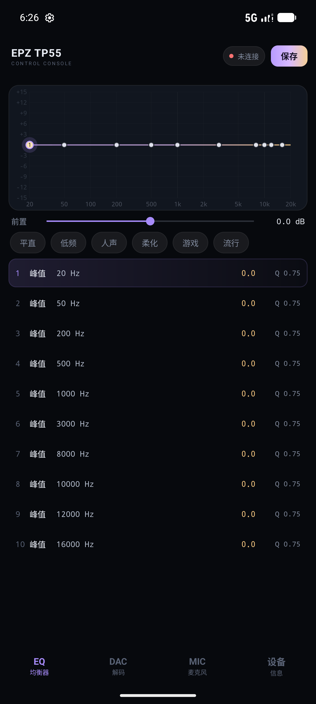
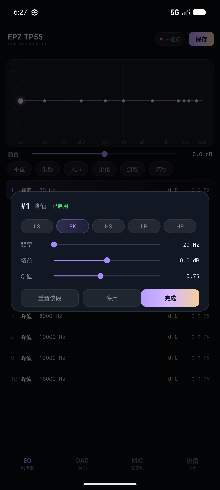

# TP55 Console

EPZ TP55 小尾巴的本地调音工具。替代官方网页版 `peq.epzsz.com`：**不用登录、不联网、连上就能调**。

桌面端（Windows · Electron）和 Android 端共用同一套设备协议与 10 段 PEQ 引擎。

## 下载

到 [Releases](../../releases) 下载对应平台的包：

| 平台 | 文件 | 说明 |
| --- | --- | --- |
| Windows | `TP55-Console-1.0-win-x64.zip` | 解压后运行 `TP55 Console.exe`，整个文件夹需保留 |
| Android | `TP55-Console-1.0-android.apk` | Android 8.0+，允许安装未知来源应用即可 |

## 界面

<p align="center">
  
  
</p>

## 功能

- **10 段参数均衡器**：峰值 / 低架 / 高架 / 低通 / 高通，20 Hz – 20 kHz，±12 dB，Q 0.1 – 10
- **实时曲线**：拖动节点改频率与增益，滚轮 / 滑块调 Q，双击复位（桌面端支持 Shift 精调）
- **实时试听**：改动写入设备运行内存，不磨损 Flash
- **保存到设备**：写入 Flash，拔插、换设备后依然生效
- **预设**：6 组内置调音（平直 / 低频 / 人声 / 柔化 / 游戏 / 流行），桌面端支持自定义预设与导入 EqualizerAPO / AutoEQ 文本
- **DAC 设置**：5 种数字滤波器、CLASS-AB / CLASS-H、输出增益（状态从设备读回）
- **麦克风增益**：3.5mm 带麦线控的通话与录音增益
- 深色界面，无需浏览器、无需账号、无遥测

## Windows 端

已编译版本直接解压运行。源码运行：

```bash
npm install
npm start
```

重新打包：

```bash
npm run dist
```

产物在 `dist/TP55 Console-win32-x64/`。

## Android 端

APK 直接安装即可。首次连接会请求 USB 访问权限，勾选「默认打开」后插上 TP55 自动连接。

源码构建需要 JDK 17+ 与 Android SDK 36：

```bash
cd android
./gradlew :app:assembleRelease
```

> 仓库不包含签名密钥。自行构建时若 `android/keystore/tp55.jks` 不存在，产物会以未签名形式输出，需要用 `apksigner` 或 Android Studio 重新签名。

## 工作方式

程序通过 USB HID（Report ID `0x4B`）直接与 TP55 通信，协议细节见 [docs/protocol.md](docs/protocol.md)。

- 采样率固定 96 kHz，biquad 系数为 30 位定点，与设备 DSP 完全一致
- 调节只写寄存器并刷新到 DSP 内存，点击「保存到设备」才写 Flash
- 桌面端启动时会自动把上次的调音下发到设备，保证界面与实际听感一致
- Android 端在设备连接后同样会自动下发当前界面参数

## 免责声明

本程序为个人独立开发的第三方本地工具，**并非 EPZ 官方软件**，与 EPZ 及其关联公司不存在任何隶属、授权、合作或背书关系。「EPZ」「TP55」等名称与标识仅用于说明兼容设备，相关商标归其权利人所有。

1. **硬件操作风险**：程序通过 USB HID 直接向设备的 DSP 与 Flash 写入参数。主要功能虽已在固件 1.4 上验证，仍可能因固件版本差异、设备个体差异、写入过程中断（拔线、断电、休眠）等导致参数异常、配置丢失或设备无响应，此类风险由使用者自行承担。
2. **听力与设备安全**：均衡器会改变输出频响与电平。对某些频段（尤其低频）大幅提升可能引起削波与失真，高音量下可能损伤听力或耳机单元。请从小幅度开始，控制回放音量；提升某频段时建议配合前置增益做整体衰减。
3. **Flash 写入寿命**：保存操作会写入设备 Flash，存在擦写次数限制。日常试听请使用实时调节，调音定型后再保存。
4. **数据与隐私**：程序完全离线运行，不收集、不上传任何数据，不包含遥测、广告或统计组件。配置仅保存在本机。
5. **无担保与责任限制**：本程序按「现状」提供，不附带任何明示或暗示的担保。在法律允许的最大范围内，作者不对因使用或无法使用本程序造成的直接、间接、偶然或后果性损失承担责任。
6. **协议来源与兼容性**：设备协议来自对官方网页前端代码的互操作性分析，仅用于与自有设备兼容。官方更新固件或修改协议后，本程序可能部分或全部失效。

首次启动时程序会要求阅读并同意完整条款，之后可在「设备 → 免责声明」随时查看。继续使用即表示你已理解并接受上述内容；如不同意，请停止使用并删除本程序。

## 注意

- 声道平衡、滤波器等设置与官方网页共用同一套设备状态，两边修改会互相覆盖
- Windows 端双击 exe 没反应时，先确认没有其他程序占用设备的 HID 接口（官方网页、其他调音软件）
- Android 端如提示「无法接管 HID 接口」，请关闭其他调音应用后重试

## 目录

```
main.js                  Electron 主进程、IPC
preload.js               安全桥接
lib/device.js            HID 通信与 biquad 编码
renderer/                桌面界面（原生 HTML/CSS/JS + Canvas）
docs/protocol.md         设备协议速查
assets/                  桌面图标
android/                 Android 工程（Java，无第三方依赖）
  app/src/main/java/com/tp55/console/
    MainActivity.java    界面与状态
    UsbHid.java          USB Host / HID 通道
    EqEngine.java        协议编解码
    EqCurveView.java     频响曲线绘制与触摸
    EqBandDialog.java    单段编辑面板
```

## 许可

[MIT](LICENSE)
